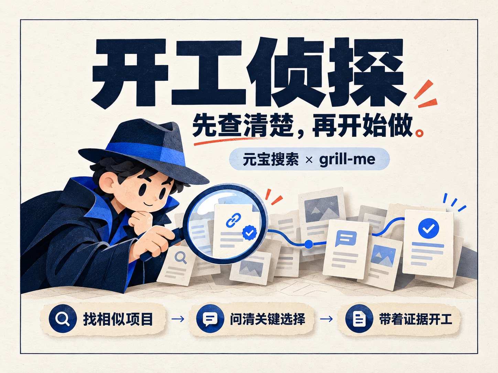
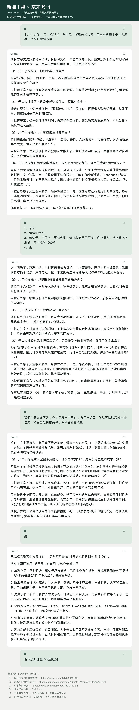
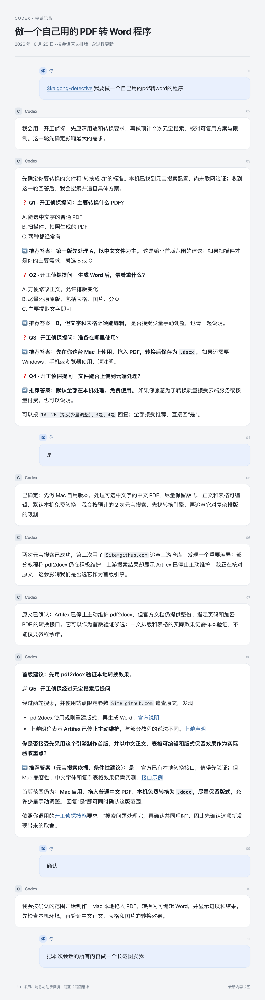
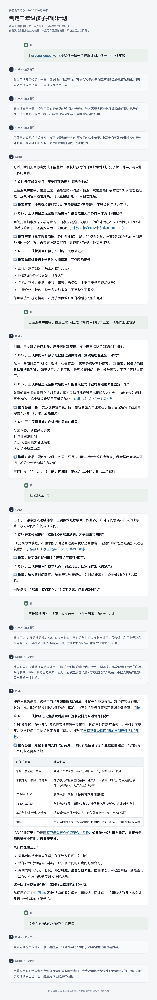
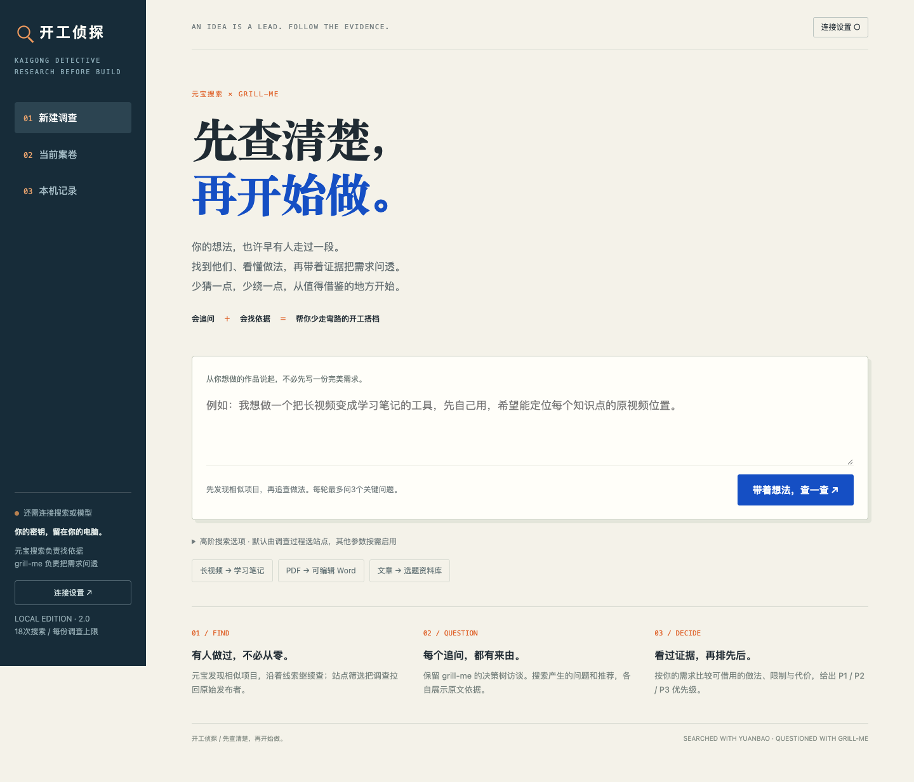
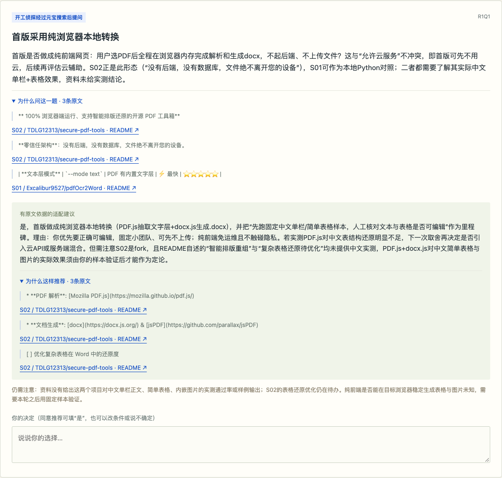

# 开工侦探



## 先查清楚，再开始做。

**元宝搜索 × grill-me：让 AI 带着证据，把你的想法问到能开工。**

**一句话介绍：** 开工侦探用元宝搜索寻找相似项目、追查真实做法，再结合热门技能 grill-me 问清关键取舍，帮想用 AI 做作品的人找到可借用的方案，少走弯路，少造重复的轮子。

[下载本地版，开始第一份调查](https://github.com/GhostArt413/kaigong-detective/releases/latest/download/kaigong-detective-local.zip) · [安装 Skill](https://github.com/GhostArt413/kaigong-detective/releases/latest/download/kaigong-detective.zip) · [了解元宝搜索](https://cloud.tencent.com/product/wsa)

> 元宝搜索驱动的开工前调查 · 核心搜索服务：腾讯云元宝搜索<br>
> 找到值得借鉴的项目，问出真正影响成败的选择，带着点得开的来源开工。

**当前公开版已实现：深度调查与带证据的需求访谈。持续盯梢、截图查证：旧网页原型已验证，正在整合进公开版。**

## 三个真实案例：做工具、做营销，也能做生活计划

开工侦探不只帮你选技术。做一份营销方案、开发一个小工具，或安排家庭日常，都有值得先查清楚的事实，以及需要结合自己条件作出的选择。

下面是使用者提供的三个独立 **Skill 使用会话长图**，按真实对话整理排版，展示在 Agent 中调用开工侦探的过程。截图保留当时的输出；当前版本的使用方式与功能状态见下文。长图可展开阅读，也可点击图片查看原图。

### 案例一｜双11营销：先问清生意，再制定促销方案

**起点：** 一家主营新疆干果的电商公司，想为第一次双11准备营销方案。

开工侦探先问渠道、目标、主推商品与预算，再通过元宝搜索查找平台相关资料和促销做法。随着使用者补充京东为主、销量优先和贴近成本价售卖等条件，追问进一步落到商品组合、底价怎么算、预售与发货怎么安排，逐步形成执行项。

**搜索带来的变化：** 把“推荐打几折”变成“先核对成本、平台规则和履约条件，再决定怎样促销”。记录也保留了尚未取得具体商家规则的缺口；平台活动条件与商品价格仍需以商家后台和实际成本核对。

<details>
<summary>展开双11营销方案完整会话</summary>

[](docs/images/cases/double11-marketing.png)

</details>

### 案例二｜PDF 转 Word：选引擎前，先查上游还在不在维护

**起点：** 做一个自己使用的 PDF 转 Word 程序。

访谈先确认 PDF 类型、版式要求、使用环境与是否允许云端处理。随后，元宝搜索沿着 GitHub 上游资料继续追查，发现 pdf2docx 的维护状态与部分旧教程说法不同，于是把上游状态、输入边界和样本验证纳入引擎选择。

**搜索带来的变化：** 推荐从“这个库能转换”推进到“先用中文正文、表格和图片验证，达到要求再决定采用”。这份会话记录到使用者确认首版范围、进入制作阶段；最终转换质量仍需用实际文件验证。

<details>
<summary>展开 PDF 转 Word 工具完整会话</summary>

[](docs/images/cases/pdf-to-word.png)

</details>

### 案例三｜孩子护眼：把公开科普落到家庭每天的安排

**起点：** 为小学三年级的孩子制定一份护眼计划。

开工侦探先区分检查诊断与家庭日常安排，通过元宝搜索查找国家卫健委等公开科普资料，再结合已有检查情况、放学时间、作业量和户外条件逐轮追问。随着使用者补充条件，计划调整为能嵌入上学日和周末的具体安排。

**搜索带来的变化：** 不停留在“多去户外、少看屏幕”，而是先核对公开建议，再讨论这家人什么时候、在哪里、由谁陪着落实。案例提供的是家庭日常用眼安排参考，不能替代检查诊断，复查与治疗遵医嘱。

<details>
<summary>展开孩子护眼计划完整会话</summary>

[](docs/images/cases/child-eye-care.png)

</details>

**三种需求，同一套方法：元宝搜索补齐事实，grill-me 问清取舍，再由使用者决定下一步。**

<details>
<summary>查看 HTML 本地版首页</summary>



</details>

## 核心能力：让每个选择，都有一条证据链

开工侦探把元宝搜索用在开工前最容易选错的地方：找得到可借鉴的项目，追得清真实做法，分得开宣传、限制和未知，再把证据变成你能作出的选择。

### 三项调查能力与实现状态

| 调查能力 | 当前公开版状态 | 已有成果与下一步 |
| --- | --- | --- |
| **深度调查** | **已实现，已完成真实联调** | 自主规划查询、依发现继续追查、读取原文、比较路线、导出带来源的调研记录。HTML 版另有独立复核调用，Skill 提供证据与开工检查。 |
| **持续盯梢** | **整合开发中，当前下载版未提供** | 旧独立网页原型已有每日调度、真实搜索检查、原文比较与站内提醒；正在整合到本次公开发布的案卷流程。 |
| **截图查证** | **整合开发中，当前下载版未提供** | 旧独立网页原型已跑通截图 OCR → 说法确认 → 元宝多轮搜索 → 证据报告，并完成短视频抽帧识别；正在整合到本次公开版。 |

三项调查工作流由开工侦探围绕元宝搜索编排，`Site` 等接口能力用于让每次查询更有针对性。

这里的“公开版”指本仓库可下载的 **HTML 本地版和 Skill**。历史原型成果与当前可用功能分开展示，原型验证记录、界面截图和未完成事项见[功能状态与验证记录](docs/advanced-status.md)。

### 已实现｜深度调查：把“推荐你用”，变成“为什么值得先试”

用户提出一个需求，开工侦探会自己规划需要查什么，调用元宝寻找相近项目；发现候选后，再沿着具体项目的实现、限制或替代路线继续搜索。取得原文后，比较不同做法，把影响范围与路线的事实交给你决定。

```text
用户需求 → 规划调查 → 元宝发现候选 → 依结果继续追查
        → 读取原文 → 比较做法与限制 → 独立复核
        → 有来源的追问、推荐、方案优先级与调研报告
```

**它交付的证据链，包含五层：**

1. **为什么查：** 查询词、实际参数、前次发现与追查原因。
2. **查到哪里：** 搜索 RequestId、时间、来源链接，区分搜索摘要与已读原文。
3. **原文说什么：** 能逐字核对的引文，以及文档是否存在版本或时间差异。
4. **影响什么选择：** 问题和推荐分别举证，说明对你当前需求的适配边界。
5. **先验证哪条路：** 给出 P1 / P2 / P3 优先级、排序理由与待核实项，导出 Markdown 留档。

多来源比对由调查流程完成，逐字引文由程序检查；HTML 本地版还会通过另一次独立模型调用，复核项目自述、旧资料冲突和问题依赖。没有足够依据时保留未知，不把文档介绍说成已经跑通。

**使用方法：** 启动本地版，输入需求，在“搜索与证据”查看真实查询与原文；在“带依据的追问”展开问题和推荐各自的出处；到“方案优先级”比较候选，最后点击“导出记录”。Skill 版另有可执行的 `check-start` 检查，在确认理解一致后核对开工条件。



*上图为当前 HTML 界面对本项目真实查询案卷的回放。使用下文 PDF 转 Word 案例的历史搜索记录，未发起新的搜索。*

### 整合开发中｜持续盯梢：今天选中的工具，明天变了也能知道

**希望解决的问题：** 调研时可以用的项目，后来可能更改说明、许可证或归档状态。已经作出的选择，也需要知道依据是否发生变化。

**已有基础：** 旧网页原型支持从报告选择已读原文的候选，建立每日检查任务，调用元宝重新搜索并刷新原始来源，比较许可证、归档状态与同一文档的正文指纹；提供立即检查、暂停、恢复及站内提醒。

**公开版整合思路：** 将候选与证据基线绑定到当前案卷，保留真实查询收据，按约定间隔重新检查；同一来源有可比变化时展示前后差异和链接，再提示用户复核原推荐。相同内容保持安静，搜索或读取失败单独记录，不冒充“来源变了”。

旧原型已真实执行两次检查，每次1次元宝查询，均未发现变化。变化提醒与去重分支使用受控测试验证；**尚没有真实外部变化触发提醒的案例**。公开版的任务入口、后台生命周期与演示材料仍在整合中；本地服务停止或电脑休眠时不能按时检查。详见[盯梢原型与整合计划](docs/advanced-status.md#持续盯梢)。

### 整合开发中｜截图查证：看见一句“AI神器”，先查它的依据

**希望解决的问题：** 看到产品截图或视频说“完全离线”“免费商用”“支持某功能”，使用者往往不知道该信哪一句、先核实哪里。

**已有基础：** 旧网页原型已完成本机 OCR，允许用户修正并确认具体说法，再用元宝多轮检索、读取原文，形成逐项核验报告；短视频先有限抽帧再识别。

**公开版整合思路：** 截图或短视频 → 本机识别文字 → 用户确认可查证说法 → 元宝发现与追查官方资料 → 原文交叉比对 → 展示支持、冲突或证据不足，再回到需求选择。

历史截图测试使用明确标为“待核验样本”的素材，完成真实 OCR、4次元宝查询和证据报告。另有4秒视频的3帧识别验证；**识别出文字只是取得线索，不能据此认定说法真实**。当前下载版尚无上传入口；OCR、视频依赖、说法确认与报告衔接仍在整合中。详见[截图原型与整合计划](docs/advanced-status.md#截图查证)。

## 你的一句“我想做”，值得先做一次功课

想用 AI 做一个网页、小工具、内容产品、机器人或 Skill，最让人心疼的，是花了时间才发现：

- 想做的功能，早有成熟项目可以借用。
- 选中的工具看起来什么都会，关键能力却没有证据。
- 跟着旧教程走了很远，才发现版本、维护状态和使用条件已经不同。
- 代码已经写了一半，自己究竟需要什么，还没说清楚。

**开工侦探把这份功课，放到第一行代码之前。**

你说想做什么，它用元宝搜索找相近项目，继续追查实现和限制，读到原文后再问你：哪些值得借用，哪些还要验证，哪些选择现在就会影响后面的路。

一次调查，帮你带走三样东西：**问清楚的需求、排过优先级的方案、能回头核对的证据。**

## 元宝搜索，让好想法更接近“做得出来”

**元宝搜索是开工侦探的调查引擎。** 相似项目发现、后续追查与查询收据都通过元宝 SearchPro 取得；原文读取和证据核对接在真实搜索结果之后，再形成有来源的问题、建议和方案比较。

用户面对的实际问题是：有没有现成方案可以借用，哪种做法更适合自己，公开介绍里有哪些关键限制。开工侦探把这些问题查清楚，再让 grill-me 帮你作出取舍。

### 找得广：把可借用的方案先找出来

元宝以**全网公开资源与腾讯优质内容生态**为信息基础。开工侦探据此寻找开源项目、组件、API、工具和 Skills，比较不同实现路径，帮你尽早发现可以站上去的起点。

对使用者来说，最有价值的发现可能就是：**这部分有人做过，我可以把时间花在自己的独特需求上。**

### 查得新：把当前可用性放进选择里

元宝官网介绍了**分钟级更新**能力。项目版本、工具能力和文档不断变化，调查时可以通过时效筛选查找近期资料，再读取来源核对，减少跟着过时信息做决定的机会。

### 查得准：沿着关键问题，追到原始发布者

需要确认某个功能，就用 `Site` 定位项目或文档所在站点；需要更合适的资料，可以按需选择时效、信源类型和垂域。开工侦探把这些能力用于具体的调查目标：**这个项目到底做到了什么，证据在哪里，对我的需求有什么用？**

### 接得上：搜索结果真正参与下一步推理

元宝面向大模型提供检索、信息去噪与结构化结果。开工侦探接收标题、链接、摘要等线索，再读取原文，把发现转成问题和推荐；实际参数、服务版本和请求编号也会留在案卷里。

以上服务能力来自[元宝搜索官网](https://cloud.tencent.com/product/wsa)。官网还标注最快 **300ms** 返回搜索结果；这是搜索服务的能力介绍，整份调查还包含多轮检索、原文读取和模型推理，耗时另计。

## 30万+ Star 的技能项目，遇上元宝搜索

[Matt Pocock 的 skills 仓库](https://github.com/mattpocock/skills)已获得 **30万+ GitHub Stars**。作者在 README 中将 grill-me 列为自己最受欢迎的技能之一：通过持续访谈，把想法拆成决策树，先问当前能决定的问题，等你回答后再展开下一层。

开工侦探保留这套“把需求问透”的方法，接入元宝搜索的真实发现：

| 你想搞清楚的事 | 元宝搜索提供调查材料 | grill-me 把材料变成决策 |
| --- | --- | --- |
| 有哪些东西可以直接借用？ | 寻找相近项目、组件、API 和 Skills | 问清你的目标与现有方案之间的差距 |
| 这个功能到底能不能做？ | 追查实现、文档和已知限制 | 问清第一版该保留什么、暂缓什么 |
| 几条路线应该先试哪条？ | 收集能力、维护和许可相关证据 | 结合你的约束，比较成本与验证顺序 |
| 推荐为什么值得相信？ | 保留搜索来源并继续读取原文 | 分别给问题与推荐举证，说明未知 |

**元宝把世界上已有的做法找回来，grill-me 把这些做法问成适合你的选择。**

每轮最多提出3个当前可以决定的关键问题。你每回答一轮，决策树就向前走一步；遇到新事实缺口，再让元宝继续查。开工侦探由此成为一个**会调查、会追问、能陪你收窄选择的开工搭档**。

*热度核对日期：2026-10-25，仓库 Stars 为302,677。该数字属于整个 skills 仓库，不是 grill-me 单个技能的安装量或效果指标；[数据来源](https://api.github.com/repos/mattpocock/skills)。本项目使用的上游固定版本见文末。*

## HTML 网页联调：PDF 转 Word，开工前查到了什么

**真实联调需求：** 做一个给自己和固定小团队使用的网页，把有文字层的中文 PDF 转成可编辑 Word，支持普通单栏、简单表格和图片，内容正确优先。

这次成功联调中，开工侦探通过元宝完成了 **2次有前后依赖的真实查询**，程序随后读取了 **6份原文**。后续访谈与独立复核复用了这批证据。

| 调查发现 | 对使用者的实际帮助 |
| --- | --- |
| 找到浏览器内转换的参考项目，也找到 Python 文本层抽取项目 | 第一版可以先比较已有路线，避免直接从零搭一整套转换系统 |
| 看到项目 README 将表格还原列为待优化事项 | 把“能导出 Word”与“我的表格能正确编辑”分开验收 |
| 发现 PyMuPDF 的旧讨论与当前文档对表格能力的描述存在时间差异 | 把版本和样本验证纳入取舍，不把历史限制直接当作今天的结论 |
| 找到云服务相关资料，但只有第三方自述、没有本次准确率实测 | 保留备选，明确还要核实什么，不提前保证转换质量 |

这些发现进入了真正需要你决定的问题：

> **开工侦探经过元宝搜索后提问（联调问题摘述）**<br>
> 第一版是否采用浏览器内完成的本地转换？<br>
> 是否同意先固定样本，再核对中文正文、表格和图片是否达到“正确、可编辑”的要求？

问题旁边可以展开“为什么问这一题”，推荐旁边可以展开“为什么这样推荐”，分别查看原文与链接。

可核对的来源：[浏览器路线参考](https://github.com/TDLG12313/secure-pdf-tools)、[文本层抽取参考](https://github.com/Excalibur9527/pdfOcr2Word)、[PyMuPDF 当前文档](https://github.com/pymupdf/PyMuPDF/blob/main/README.md)、[历史表格讨论](https://github.com/pymupdf/PyMuPDF/discussions/1021)。

*这是调研链路联调，尚未由使用者确认最终路线，也没有开发或实测 PDF 转换工具。两个搜索请求编号为 `4ca04bc8-1d72-4781-830a-94596d210f51`、`4a7bd502-4efc-4c16-b3f1-88e11dca450c`；RequestId 用于追踪，不证明结论正确。*

## 把“查得到”，做成“用得上”

- **问题有来由，推荐有出处。** 普通提问与元宝搜索启发的提问分开展示；问题和推荐分别引用原文。
- **沿着线索继续查。** 首次调查先发现，再依据结果追查具体实现或限制，保留前后关系和原因。
- **把选择排出先后。** 按需求匹配、证据、维护、复用成本和许可给出 P1 / P2 / P3 优先级，告诉你先验证哪里。
- **给引用再上一道检查。** 程序核对逐字引文，再独立复核项目自述、新旧材料冲突和问题依赖。资料不足就明确留白。
- **让你能审阅、能带走。** 查询参数、请求编号、原文材料、往轮回答都可查看，调研记录可导出为 Markdown。
- **让第一次接入更容易。** 没有元宝 Key 时提供创建指引；已有配置直接复用，密钥在本机保存、不回显。

## 高阶搜索能力，落到每一次有目的的调查

| 元宝能力 | 在开工侦探中怎样用 | 帮使用者解决什么 |
| --- | --- | --- |
| `Site` 站点筛选 | 按调查目标定位项目或官方文档所在域名 | 追到具体做法与发布者说明，减少只看转载介绍 |
| `Freshness` 时效筛选 | 按需查找近期内容；网页提供近3个月、近1年选项 | 面对不断变化的版本和产品，优先核对当前信息 |
| `Mode` 信源类型 | 选择公开网页、权威垂直信源或混合结果 | 按问题选择资料范围 |
| `Industry` 垂域检索 | 网页支持学术、资讯，Skill 接入官方参数白名单 | 为不同问题补充相应领域的资料 |
| `Deeplinks` 附件子链 | 按需请求附件线索 | 找到值得继续追查的材料入口；不等于已读取附件 |
| `Cnt` 返回条数 | Skill 可调整服务端结果条数 | 为候选比较收集更多线索，再由调查流程核对 |

这些参数作为真实 JSON 字段发送给 SearchPro，案卷展示当次实际使用了什么。多轮追查和证据复核由开工侦探编排，接口说明见[元宝搜索 API 文档](https://cloud.tencent.com/document/product/1806/121811)。

<details>
<summary>查看版本支持与实测范围</summary>

`Mode`、`Industry`、`Cnt` 不适用于极速版，`Deeplinks` 需要旗舰版；以腾讯云当前文档与账号版本为准。`Site` 站点筛选只对自然网页结果生效，不限制 VR 卡。

当前网页已真实验证 `Site`；其余高阶选项已接入并做离线参数校验，尚未在当前账号逐项实测。高阶参数按需要启用，失败保留记录，不自动购买或升级服务。本地 `limit` 只截取展示列表，不改变单次请求费用。

</details>

## 使用方式一：下载 HTML 本地版

**不需要 Codex，不需要 Node.js，不需要安装 pip 依赖。需要 Python 3.10+、现代浏览器，以及你自己的元宝搜索和大模型接口。**

1. 下载 [完整本地版 ZIP](dist/kaigong-detective-local.zip)，解压并保留文件夹结构。
2. 在解压目录执行下面的启动命令，或使用附带启动文件。
3. 浏览器打开后，在右上角“连接设置”保存自己的元宝服务 API Key、模型 Base URL、模型名称和模型 Key。
4. 输入需求，等待第一轮真实调查，逐题回答，再查看“方案优先级”“搜索与证据”。

macOS / Linux：

```bash
python3 standalone/server.py
```

Windows：

```powershell
py -3 standalone/server.py
```

macOS 也可以双击 `start.command`，Windows 可以双击 `start.bat`。若 macOS 未给启动文件执行权限，直接用终端命令即可。系统安全提示、未安装 Python 时，按提示处理后再启动。

默认打开 **http://127.0.0.1:8790**。端口被占用时：

```bash
python3 standalone/server.py --port 8791
```

**HTML 是一个文件，真实接口调用由随包附带的本机服务完成。** 页面 CSS 与 JavaScript 已内嵌，没有 CDN 或前端构建步骤。直接双击 `standalone/开工侦探.html` 会显示启动说明；单独下载 HTML 并不能绕过浏览器跨域限制直接完成调查。只有 `python3 -m http.server` 这样的静态托管也不够。

本地部署指界面、配置和案卷在自己电脑上运行；搜索仍需联网，模型可选云 API 或本机 OpenAI 兼容服务。云模型需要能稳定返回 JSON；接口地址应包含服务要求的 `/v1`，不用填写 `/chat/completions`。不保证所有“兼容”服务的模型都支持本应用的结构化输出。

### 第一次连接元宝

- 前往[元宝搜索控制台](https://console.cloud.tencent.com/wsapi/index)，按照[官方说明](https://cloud.tencent.com/document/product/1806/130615)创建**服务 API KEY**，在本地页面填写。
- 不需要把密钥发给作者，不需要填写 KeyName，也不要混用聊天模型 Key 或腾讯云 SecretId/SecretKey。
- 已有 `TENCENTCLOUD_WSA_APIKEY` 环境变量或 `~/.config/yuanbao-search/.env` 时直接复用。
- 点击“保存”只表示保存成功；“测试元宝”会真实调用1次，可能消耗额度。也可以省略测试，用首次实际调查验证。

### 配置、费用和数据

- 配置保存在 `~/.config/kaigong-detective/config.json`；案卷保存在 `~/.local/share/kaigong-detective/sessions/`。POSIX 系统中新文件权限为 `0600`。
- 支持环境变量 `TENCENTCLOUD_WSA_APIKEY`、`SCOUT_LLM_BASE_URL`、`SCOUT_LLM_MODEL`、`SCOUT_LLM_API_KEY`，优先于本机配置。更换模型服务地址时要求新密钥，避免把旧服务的 Key 发给新地址。
- 搜索请求、发现的公开原文、你的需求和回答会参与调查。**需求、回答、搜索材料会发送给所配置的模型服务；搜索词会发送给元宝。** 请按自己的数据要求使用。
- 每份调查最多18次搜索尝试；首次通常2次，之后按事实缺口追加。失败请求也可能消耗额度，模型调用另计。本项目不附赠额度，不自动购买或升级服务。
- 默认只监听本机 `127.0.0.1`，不提供账户系统、多人权限或公网部署方案。配置和案卷不进入下载包；导出的报告也不包含密钥。
- 服务中断时已落盘记录保留，未结束的一轮可重试。已返回的报告和引文仍需你审阅。

## 使用方式二：在 Agent 中安装 Skill

已有支持本地 Skills 的 Agent 时，使用技能版即可。它直接使用 Agent 的推理模型，不要求单独配置聊天模型 API；需要 Python 3 执行元宝调用和证据脚本。原文读取由所在 Agent 的工具完成。

下载 [Skill ZIP](dist/kaigong-detective.zip) 或 [.skill 包](dist/kaigong-detective.skill)，把解压得到的整个 `kaigong-detective` 目录放进 Agent 的技能目录。以 Codex 为例：

```text
~/.codex/skills/kaigong-detective/SKILL.md
```

新开聊天后调用：

```text
$kaigong-detective 我想做一个把长视频整理成学习笔记的工具。
先帮我查相似项目和实际做法，带着来源问清关键取舍，列出值得借鉴方案的优先级。
```

没有元宝连接时，技能会引导你在自己的终端隐藏输入 Key，Codex 默认安装路径下可用：

```bash
python3 ~/.codex/skills/kaigong-detective/scripts/connect.py configure --test
```

`--test` 会使用1次真实搜索；仅保存配置可去掉它。原 grill-me/grilling 无需删除或覆盖。

### 两种形态的区别

| | Skill | HTML 本地版 |
| --- | --- | --- |
| 使用入口 | 支持 Skills 的 Agent | 浏览器 |
| 模型 | 使用当前 Agent | 自填 OpenAI 兼容接口 |
| 原文读取 | Agent 可用工具 | 标准库网页读取、GitHub README 与元数据 |
| 证据约束 | 完整证据格式、`check-start` 开工检查 | 实际搜索收据、原文引文匹配、访谈结论确认检查 |
| 开工 | 检查通过且用户已授权后，由 Agent 制作 | 导出调研结论，由你决定下一步；网页不自动写目标项目 |

网页版按相同核心方法独立实现访谈，不在后台运行 Codex，也不声称执行了技能脚本的 `check-start`。完整 Skill 保存在同一仓库，两个入口都可分发。

## 实现思路

本地版只有一个内嵌 CSS / JavaScript 的 HTML 和一个 Python 标准库本地服务。后端复用技能的 SearchPro 参数校验与响应规范化逻辑，模型负责规划搜索和组织访谈，程序负责预算、请求收据、原文读取、引文匹配、候选降级及本机存储。

首次查询的结果进入第二次追查规划，追查必须指向前一次真实结果 URL；它们不是两次互不相关的搜索。原文进入访谈上下文后，模型分别给问题与推荐引用；后端拒绝不存在于已读原文的引文。输出前再做一次独立证据复核，检查项目自评是否被夸大、旧资料是否与新文档冲突；复核只能保持或降低原优先级。你回答后重算决策树。访谈收束、至少一条带双重依据的问题得到你的回答等条件满足后，才提供结论确认。

引用逐字匹配只能排除一部分伪造，不能保证语义理解完全正确。文档写有某能力，也不代表我们安装并验证了它；项目是否适合自己的真实文件和工作流，仍需小样本验证。

### 仓库结构

```text
standalone/开工侦探.html     单文件网页
standalone/server.py         标准库本地服务
standalone/preview.png       真实界面截图
skills/kaigong-detective/     完整技能与元宝接入脚本
docs/advanced-status.md      三项进阶能力的状态、原型截图与整合计划
scripts/build_release.py     构建并检查分发包
tests/test_standalone.py     本地版的离线行为验证
dist/                       HTML 本地版、Skill 下载包
THIRD_PARTY_NOTICES.md       上游来源与许可说明
```

开发验证：

```bash
python3 -m pip install pytest
python3 -m pytest tests/test_standalone.py -q
python3 scripts/build_release.py
```

分发包只选择必要源码与公开说明，不打包配置、案卷、聊天记录或开发环境。

## 产品使用与验证

从一个真实需求开始：寻找能借用的项目、核对关键能力，或比较不同实现路线。调查过程中，查看搜索记录和原文，结合自己的约束回答问题，再核对推荐理由与待验证项。调研记录可以导出，方便后续实现和复查。

当前公开版提供深度调查。持续盯梢与截图查证已有历史原型，正在整合到公开版；功能状态、验证记录和使用限制见[能力说明](docs/advanced-status.md)。

调查围绕公开产品、技术、工具、项目与可核实的公开知识展开；元宝搜索用于补齐事实，具体选择结合使用者自己的条件。使用自己的元宝搜索和模型 API；代码与下载包不含共享密钥。

## 来源与致谢

- [腾讯云元宝搜索](https://cloud.tencent.com/product/wsa)：开工侦探的核心搜索服务，支持相似项目发现、资料追查和有来源的需求调研。
- [Matt Pocock / skills](https://github.com/mattpocock/skills)：grill-me/grilling 决策树访谈的上游。原文件与 MIT 许可证收录于 `skills/kaigong-detective/references/upstream/`，固定版本和哈希见 `provenance.json`。
- 本地 HTML 的中文访谈与搜索编排是开工侦探的实现。公开资料、作者的选择理由、适配推断和实测结果分别对待，能查清的尽量查清，查不清的说不知道。

上游使用条件见 [THIRD_PARTY_NOTICES.md](THIRD_PARTY_NOTICES.md)，分发包保留原始文件、署名和许可文本。
