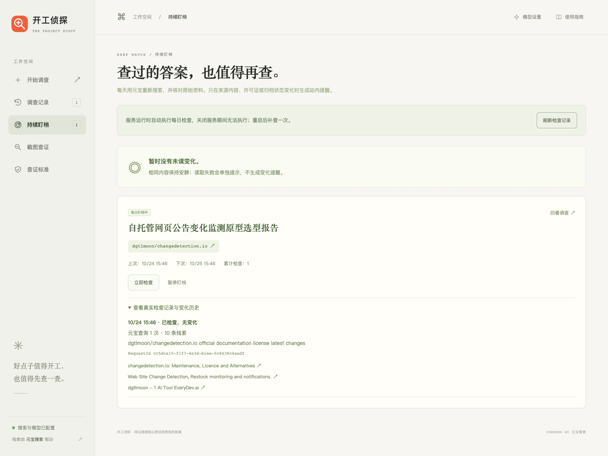
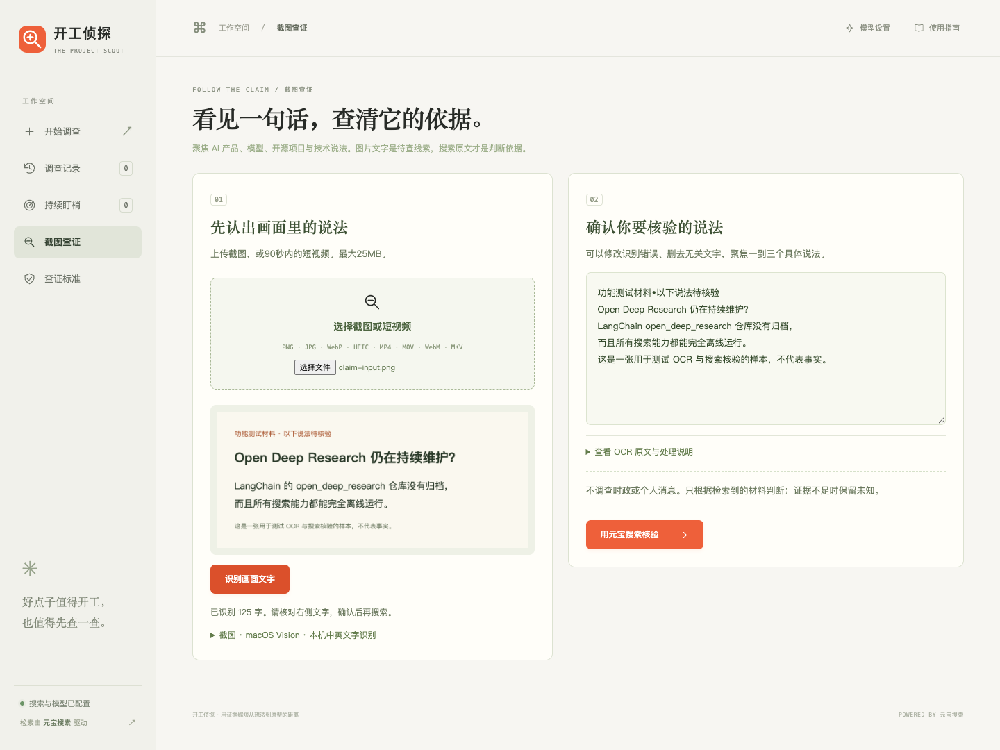

# 调查能力：实现状态与验证记录

核对日期：2026-10-25。本页区分当前公开下载版、历史独立网页原型与正在整合的功能，避免把不同版本的能力混在一起。

## 当前公开版

本仓库提供 HTML 本地版与 kaigong-detective Skill。当前可直接使用的进阶能力是**深度调查**：规划查询、依发现追查、读取原文、比较不同做法，以及带来源的访谈和调研记录导出。HTML 本地版包含独立模型复核调用；Skill 使用 Agent 核验、证据格式检查与 check-start 开工检查。

持续盯梢与截图查证的历史原型已经有实现及验证记录；相应旧网页运行时尚未打包到本仓库的公开版。本页展示历史验证摘要和截图，不将它们标成当前下载版已有入口。

## 深度调查

### HTML 本地版已经实现

1. 模型根据需求规划待查问题，调用真实元宝搜索发现相近项目。
2. 下一次查询必须引用前一次真实结果 URL，说明追查理由。
3. 读取搜索发现路径上的原文；原文失败保留摘要线索。
4. 分别为问题、推荐与候选选择引文，程序核对引文是否在原文中。
5. 独立复核调用检查项目自述、新旧资料冲突、问题依赖；不能擅自增加候选或提高优先级。
6. 记录查询参数、服务版本、RequestId、来源与用户回答，导出 Markdown。

代码入口：[调查与报告](../standalone/server.py)、[Skill 的证据检查](../skills/kaigong-detective/scripts/evidence.py)、[Skill 的访谈格式](../skills/kaigong-detective/references/report-schema.md)。

### 真实联调与展示

2026-10-25 的 PDF 转 Word 调研完成2次相关查询、6份原文读取，搜索 RequestId：

- `4ca04bc8-1d72-4781-830a-94596d210f51`
- `4a7bd502-4efc-4c16-b3f1-88e11dca450c`

后续访谈与复核复用该批证据。截图使用当前界面回放同一份真实历史案卷，未新增搜索。

可现场演示：新建调查 → 输入需求 → 查看查询和追查原因 → 展开原文 → 回答问题 → 比较方案 → 导出记录。使用者尚未确认最终路线时，报告保持未确认状态；公开资料核对不等于已运行候选项目。

## 持续盯梢

**状态：历史原型已有验证，公开版整合开发中。**

### 已有原型基础

- 从完成报告中选择1–3个已读原文的候选，保存比较基线。
- 每项任务每24小时检查一次；创建后先检查，支持立即检查、暂停、恢复。
- 每次调用元宝搜索，并强制刷新候选原文与仓库资料。
- 对比已确认的许可证、归档字段和同一文档的正文指纹；不同文档之间不直接比较正文。
- 保留近30次检查和站内提醒；相同变化不重复提醒，读取失败单独记录。

2026-10-24，原型对同一个公开项目真实执行两次检查，每次1次元宝请求，两次均无变化。RequestId：

- `cc5dca15-f1f7-4e3d-b1ee-0c8438c4aadf`
- `f52f6acb-6237-4ad0-a671-74c0e7e1ef96`

变化提醒、去重、到期调度及失败处理有受控测试；没有真实外部变化触发提醒的案例。两次立即检查不能替代连续多日自动运行验证。测试任务已暂停，截图是历史检查画面，不说明任务目前仍运行。

### 公开版整合思路

把跟踪项绑定到当前案卷，以已读来源建立基线；增加任务列表与调度生命周期，在用户启用后定期检索、刷新原文、比较可比字段。发现变化时显示前后差异、原始来源及该次搜索收据，提示复核受影响的推荐。

仍需把旧原型的存储、暂停恢复、站内提醒和预算控制整合进当前本地服务，完成重启与重复提醒回归，再录制公开版演示。计划沿用服务常驻时每日检查的方式；电脑休眠或服务关闭期间不能执行，不自动向邮件或聊天工具发消息。

## 截图查证

**状态：历史原型已有验证，公开版整合开发中。**

### 已有原型基础

2026-10-24，旧网页用明确标注“待核验样本”的公开技术说法素材，完成真实的本机 OCR → 确认说法 → 4次元宝检索 → 原文核验报告。它是识别与查证流程测试，不是截取自真实社交传播的传言，也没有把测试说法当成事实。

另有4秒短视频抽帧识别验证，抽取0、2、3.5秒三帧。旧原型的限制为：文件不超过25MB，视频不超过90秒、最多抽3帧；没有分析音轨，也没有覆盖全部画面。

旧原型已使用 macOS Vision 实现本机中英文 OCR，也提供 Tesseract 路径；视频处理使用 FFmpeg。上传素材临时处理后清理，识别出的文字在用户确认提交后进入报告。

### 公开版整合思路

1. 增加上传与本机识别入口，保留尺寸、时长和依赖检查。
2. 让用户修正 OCR 错误，并选择要核验的具体说法。
3. 把说法拆成元宝查询，按需要定位原始发布者、追查当前文档和限制。
4. 原文核对后给出支持、冲突或证据不足，并分别展示依据。
5. 将结果接回当前案卷：哪些事实影响原需求，是否应修改推荐。

尚需完成与当前轻量本地服务的上传、依赖检测、说法确认及报告衔接，并补充公开版端到端演示。当前 HTML 下载版没有上传入口，Skill 也没有自带 OCR 或定时执行器；不因所在 Agent 偶有相关能力，就将其算作本项目已实现。

## 如何复现和验证

- 以真实需求开始调查，检查查询、追查原因、原文引文、未知项与导出的记录。
- 使用不同问题验证结果和来源；历史案卷回放用于复查已有证据，不会重新搜索。
- 历史原型截图标明版本和日期，受控测试与真实外部变化分别记录。
- 持续盯梢与截图查证完成公开版整合后，提供对应入口与端到端使用示例。
